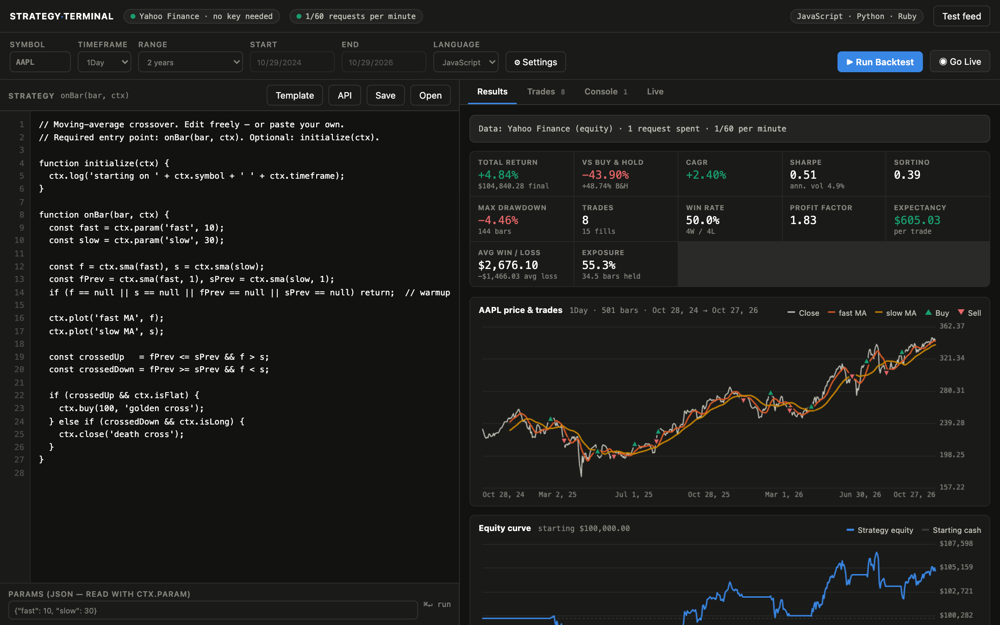

# Strategy Terminal

A local terminal for testing trading strategies. Paste a strategy in **Python,
JavaScript, or Ruby**, pick the language from a dropdown, and run it over historical bars
— or forward-test it on live bars with simulated fills.

Zero npm dependencies, and **no API key to get**: data comes from Yahoo Finance, which is
public. Nothing leaves your machine except those price requests.



**Stack:** Node.js with zero npm dependencies · a vanilla HTML/CSS/JavaScript front end · strategy
runners in Python, JavaScript and Ruby, each in its own subprocess · Yahoo Finance data, cached on disk

```bash
node server.js          # → http://localhost:4477
node selftest.js        # runs the same strategy through every runtime and checks they agree
```

## How it works

```
browser UI  ──▶  server.js  ──▶  providers/yahoo.js   ─ no key, no quota
                    │                  └─ disk cache + usage counter
                    ├──▶  runners/python.py    ─┐
                    ├──▶  runners/javascript.js ├─ your code, in a subprocess
                    └──▶  runners/ruby.rb      ─┘   emits ORDERS only
                    │
                    └──▶  engine.js  — fills, portfolio accounting, statistics
```

Two pluggable axes, same idea both times: **languages** in `runners/`, **data feeds** in
`providers/`. Neither knows the other exists, and `engine.js` knows about neither.

The split matters: **a runner only turns bars into orders.** Every dollar of the
simulation — fill prices, slippage, commissions, position accounting, equity, stats —
happens in `engine.js`. That's why the same strategy gives byte-identical results in
all three languages, and why adding a language can't quietly change your numbers.

The provider is isolated behind three functions (`fetchBars`, `latestQuote`, `usage`),
registered in `providers/index.js`. That seam is why swapping feeds never touched the
engine or the runners — this project moved Alpaca → Alpha Vantage → Finnhub → Yahoo and
the self-test kept passing untouched each time, and it's why settling on Yahoo permanently
still left the registry in place rather than hardcoding a require.

The browser can't reliably call Yahoo's endpoint directly (CORS), so the fetching lives in
the local server, which binds to `127.0.0.1` only.

## Data: Yahoo Finance, and nothing to configure

**There is no API key anywhere in this app, and no way to add one.** Yahoo's v8 chart
endpoint is public, so there is no account, no quota, no key file and no connect step —
the terminal just works when you start it.

It returns 40+ years of split-adjusted daily bars: 8,443 for `SPY` back to 1993-01-29,
16,263 for `KO` back to 1962, 24,772 for `^GSPC` back to 1927. Symbols are Yahoo-style —
bare tickers for US equities (`AAPL`, `SPY`), `^GSPC` for indices, `BTC-USD` for crypto,
`EURUSD=X` for forex.

The one real limit is intraday depth, and it can't be worked around: **8 days per request
for 1Min**, 60 days of 5–30Min, 730 days of 1Hour. Deep history means `1Day` or longer.

**Test feed** in the header spends one request on a single AAPL bar, for when the question
is "is it me or is it Yahoo".

<details>
<summary>Why the other two providers were removed</summary>

Finnhub and Alpha Vantage were both supported until 2026-08-16 and are gone along with the
entire key mechanism (ST-10). Neither could do the job:

- **Finnhub** paywalled historical candles — free keys get 403 on `/stock/candle` *and*
  `/crypto/candle` (verified 2026-08-15, ST-5). Unusable for backtesting without paying.
- **Alpha Vantage** allows 25 requests/day, and its free daily bars are **not
  split-adjusted**, so every split reads as a real overnight crash.

Their modules are in git history at commit `e1facd9` if a paid plan ever makes one worth
reviving, and `providers/index.js` is still a registry — a new feed is one module plus one
entry, with nothing else to change.
</details>

### Picking a date range

The runbar has a **Range** dropdown — `1 month` through `20 years`, `YTD`, **`Max`**, and
`Custom…`. Presets resolve to real start/end dates in the browser and fill the two date
boxes so you can see the exact window that will run; the boxes only become editable under
`Custom` (typing in one switches to `Custom` for you).

**`Max` means "since the symbol's first trade", not "as far back as the feed feels like".**
The browser can't know when a ticker listed, so `Max` travels to the provider as
`range: 'max'` and Yahoo resolves it from `meta.firstTradeDate` — a one-bar probe request,
cached for 30 days because a first trading day never changes. The resolved date comes back
in `meta.inception` and is printed in the results header (`SPY first traded 1993-01-29`).

Verified reach: `SPY` 8,443 bars to 1993-01-29 · `NVDA` 6,933 to 1999-01-22 · `KO` 16,263 to
1962-01-02 · `^GSPC` 24,772 to 1927-12-30 (negative epochs work fine).

Two things `Max` will tell you about rather than hide:

- **The Max bars cap clips the oldest bars, not the newest.** `^GSPC` has 24,772 daily bars
  and the default cap in Settings is 20,000 — the run silently started in 1947 until the
  results pane began warning about it. Raise **Max bars** to test the whole range.
- **Intraday can't go back far, whatever Range says.** 1Min is 8 days *per request*, 5–30Min
  60 days, 1Hour 730 days. `Max` on an intraday timeframe clamps to that window and the
  results pane says so. Deep history means `1Day` or longer.

### Two Yahoo details that would silently corrupt a backtest

Both are handled in `providers/yahoo.js`, and both are worth knowing if you ever touch it:

- **`range=max` is a trap.** It doesn't mean "max daily bars" — Yahoo quietly coarsens the
  interval to fit its bar budget, returning ~168 bars for 42 years of `interval=1d`. That
  looks like data but is roughly quarterly. The provider always sends explicit
  `period1`/`period2` epochs, which yields the true ~252 bars/year.
- **The OHLC Yahoo ships is raw, not adjusted.** Only `adjclose` is adjusted. AAPL's first
  bar is `0.1244` raw vs `0.0951` adjusted across 5 splits — feed the raw series to the
  engine and every split books as a real overnight crash. The provider scales each bar's
  open/high/low/close by `adjclose/close` before returning it.

### Everything is cached

Every response is cached to `data/`; re-running a backtest over a range you've already
pulled costs **zero** requests, and the results header tells you which happened. Yahoo
publishes no quota, so the header pill tracks a self-imposed 60/minute courtesy ceiling
purely so runaway polling is visible.

Deep history is one request: daily/weekly/monthly come back 40+ years in a single call.
Live mode spends one request per tick, and a Max-range session fetches its full history
once at start and then polls only a recent window.

### Single-bar gaps are still flagged

Yahoo bars are scaled to `adjclose` before they reach the engine, so a split can't book as
P&L. The ±40% single-bar gap warning stays anyway — with adjustment handled, a surviving
gap means real news, a corporate action, or a thin symbol, all of which are worth a look
before you believe the numbers.

## Writing a strategy

| | entry point | optional setup |
|---|---|---|
| Python | `def on_bar(bar, ctx):` | `def initialize(ctx):` |
| JavaScript | `function onBar(bar, ctx)` | `function initialize(ctx)` |
| Ruby | `def on_bar(bar, ctx)` | `def initialize_strategy(ctx)` |

Same `ctx` concepts everywhere — snake_case in Python/Ruby, camelCase in JavaScript.
The **API** button in the UI has the full list.

```python
def on_bar(bar, ctx):
    fast, slow = ctx.sma(10), ctx.sma(30)
    if fast is None or slow is None:      # warmup
        return
    if fast > slow and ctx.is_flat:
        ctx.buy(100, "cross up")
    elif fast < slow and ctx.is_long:
        ctx.close("cross down")
```

**Orders:** `buy(qty, reason)` · `sell(qty, reason)` · `close(reason)` · `target(qty, reason)`
**Position:** `position` `avg_price` `is_long` `is_short` `is_flat` `cash` `equity` `unrealized`
**History:** `closes` `opens` `highs` `lows` `volumes`, and `close_(n)` for n bars back
**Indicators:** `sma ema rsi atr stdev highest lowest roc`, each taking `(length, back=0)`
**Levels:** `window touched count_touches pivots levels retest` — see below
**Output:** `ctx.log(...)` → Console tab · `ctx.plot(name, value)` → overlays the price chart
**Params:** `ctx.param('fast', 10)` reads the Params JSON box, so you can tune without editing code

### Price levels — "has price been here before, and is it here again?"

Indicators smooth the series; these read it as an array and ask about *specific prices*
that price has turned at before. `tol` is always a **fraction of the level's own price**
(`0.002` = a 0.2% band), because two bars never reach the same level to the cent.

| call | answers |
|---|---|
| `window(n, src)` | last *n* values as a plain array, oldest first |
| `touched(level, tol, back)` | did that bar's range reach this price? `back=1` = yesterday |
| `count_touches(level, lookback, tol)` | how many **earlier** bars reached it (today excluded) |
| `pivots(left, right, lookback, kind)` | confirmed swing points, oldest first |
| `levels(tol, left, right, lookback, min_touches)` | pivots clustered into levels, most-touched first |
| `retest(tol, left, right, lookback, min_touches)` | the level **today** is revisiting, else `None` |

`levels()` returns `{price, kind, touches, last_i, bars_ago}` — `kind` is `'high'`,
`'low'` or `'both'`, and `touches` is how many times price turned there, so
`min_touches=2` means "only levels the market has respected more than once". JavaScript
uses `countTouches` / `barsAgo` / `lastI`; Python and Ruby use snake_case.

The literal version of "yesterday it reached a point, today it reaches it again":

```python
def on_bar(bar, ctx):
    y = ctx.high_(1)                      # yesterday's high
    if y is None:
        return
    if ctx.touched(y, 0.001) and ctx.is_flat:
        ctx.buy(reason='revisited yesterday high %.2f' % y)
```

And the version that finds the levels for you rather than being told one:

```python
def on_bar(bar, ctx):
    lv = ctx.retest(0.004, 2, 2, 250, min_touches=2)
    if lv and lv['kind'] == 'low' and ctx.is_flat:
        ctx.buy(reason='retest support %.2f (%d touches)' % (lv['price'], lv['touches']))
```

`strategies/Level Retest.json` is that idea complete with a stop and a target — open it
from the **Open** button. On SPY daily over 5 years it takes 30 trades, wins 30% of them
and returns −1.8% against buy & hold's +86.9%. It is a **worked example of the API, not a
profitable system** — treat it as a starting point to beat, the same way the 50/200
crossover is.

**One thing about pivots that is real and not a bug:** confirming a swing high requires
`right` bars *after* it, so a level only becomes visible a few bars after it formed. At the
moment of the turn, nobody knows it was a turn. `selftest.js` proves the runners honour
this — it re-runs the same strategy on a series truncated at bar 300 and asserts the level
view is byte-identical to the full-series run.

### Two rules worth internalising

**No lookahead.** `ctx` never exposes a bar past the current one. Indicators are
precomputed for speed, but every formula is causal — index *k* only ever depends on
bars ≤ *k* — so precomputing can't leak the future.

**Fills are pessimistic by default.** A signal on bar *i* fills at the **open of bar
i+1**, the earliest price you could realistically have transacted at. Settings can
switch to same-bar close, but that flatters results — it assumes you saw the close
and traded at it. Add slippage and commission there too; a strategy that only works
at 0 bps isn't a strategy.

## Live mode

**Go Live** warms up on history, then polls Yahoo for new bars and re-runs your strategy
forward. Fills are **simulated** — no order is placed anywhere. The live portion of the
run is shaded on the charts.

Cadence follows the bar size rather than a budget: 30s on intraday timeframes, 120s on
daily and up, floored at 30s server-side. There is no quota to exhaust, so a session runs
until you stop it.

## Adding a provider

Yahoo is permanent, but the seam is still there. Write `providers/<name>.js` exporting
`fetchBars({symbol, timeframe, start, end, limit, force, range}) -> {bars, meta}`, plus
`latestQuote`, `usage`, and `TIMEFRAMES`. Register it in `providers/index.js`. Nothing
else changes.

There is deliberately no credential plumbing left, so a feed needing a key means adding
that back — see `e1facd9` for how it looked.

`range: 'max'` overrides `start` and means "from inception". Resolve it however your feed
allows — Yahoo reads `meta.firstTradeDate` — and report what you resolved in
`meta.inception` / `meta.requestedFrom`.
If `limit` clips bars, say so in `meta.truncated`; the UI turns that into a warning.

## Adding a language

1. Write `runners/<lang>.<ext>` — read the request JSON (argv[1]), walk the bars calling
   the user's entry point, write `{ok, orders, logs, plots}` to argv[2].
2. Add one line to `LANGUAGES` in `engine.js`.
3. Add a starter template to `TEMPLATES` in `public/app.js`.
4. Run `node selftest.js` — it will pick the new runtime up and check it agrees with the others.

Use `runners/python.py` as the reference; it's pure stdlib and the easiest to port.

## Notes

- Timeframes: `1Min 5Min 15Min 30Min 1Hour 1Day 1Week 1Month`. Ranges: `1m 3m 6m YTD 1y 2y
  5y 10y 20y Max Custom`.
- No credentials file, no API key, nothing to configure. `.gitignore` still covers
  `.credentials*` so an old key left on disk can never be committed.
- `data/` (cached bars + the usage counter) is gitignored too — delete it any time to
  force fresh fetches, at the cost of requests.
- Backtest results are not predictions. Optimising params until the curve looks good is
  how you overfit; treat the numbers as a way to reject bad ideas, not confirm good ones.
